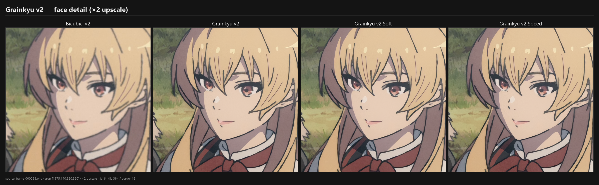
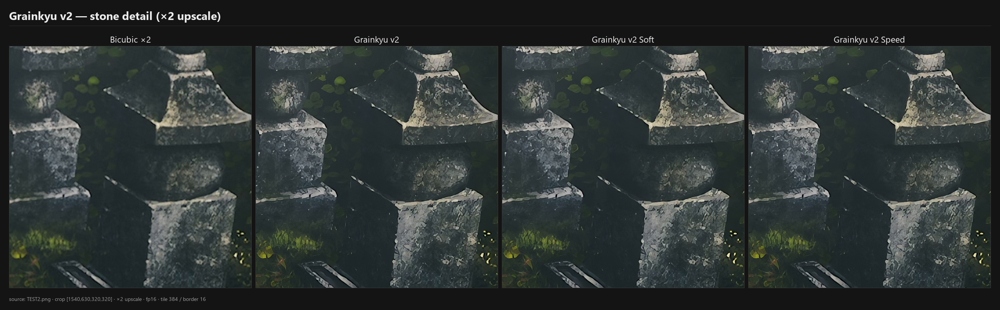
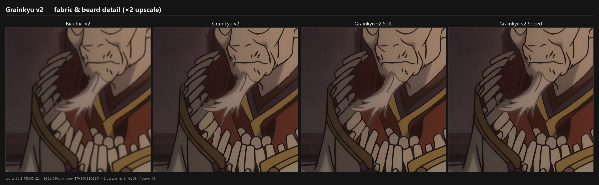

# Kyu model

[ENG](#eng) · [RU](#ru)

## ENG

**Grainkyu v2** is a family of 2× ONNX models for anime upscaling, with crisp linework, fine detail, and natural-looking texture.

### Choosing a version

The models add subtle grain to give the image a more natural look, avoiding overly smooth, plastic-like surfaces. Each version offers a different balance of grain, quality, and speed.

- **Grainkyu v2** — the main model, focused on maximum quality and detail.
- **Grainkyu v2 Soft** — nearly the same sharpness, with less grain. A good choice for anime that already has pronounced grain in the source.
- **Grainkyu v2 Speed** — quality close to v2 on a more compact architecture. Runs noticeably faster, making 4K anime playback more accessible on less powerful hardware. On an RTX 3070, it achieves **36 FPS** at 1080p → 4K, enough for real-time playback of 24–30 FPS content.

### Model specifications

| Model | Size | Parameters |
|---|---|---|
| **Grainkyu v2** | 1.90 MB | 970,672 |
| **Grainkyu v2 Soft** | 1.88 MB | 970,672 |
| **Grainkyu v2 Speed** | 0.70 MB | 358,800 |

| Property | Value |
|---|---|
| Format | ONNX, float16 input and output |
| Scale | ×2 |
| Input | RGB, NCHW, `float16`, values in `[0, 1]`; H and W must be even; v2 requires batch size 1 |
| Output | RGB, NCHW, `float16`, ×2 in each spatial dimension |

### Examples

The [`examples/`](examples/) directory contains frames from various anime processed by all three models, alongside the originals and bicubic upscales. Examples are grouped by anime title: `orig.png` is the source frame, `bicubic.png` is the bicubic upscale, and `Grainkyu_v2*.png` are the model outputs.

#### Detail crops

Each comparison below shows the same 320×320 crop from a 1920×1080 frame, upscaled to 640×640. Model outputs are shown without further resizing; `Bicubic ×2` uses standard bicubic interpolation (Pillow BICUBIC).

In these frames, v2 and Soft have similar edge clarity, with differences more apparent in grain and texture. Speed retains a similar overall look, although fine details sometimes differ from the main model.

**Face: eyes, hair, ribbons**

**Carved stone and moss**

**Beard, fabric, and necklace**

### RTX 3070 performance

NVIDIA GeForce RTX 3070 8 GB (driver 610.62), Windows 11, TensorRT 11.2.1.2, FP16.

#### Video processing, 1920×1080 → 3840×2160

| Model | FPS |
|---|---|
| **Grainkyu v2** | **26.5** |
| **Grainkyu v2 Soft** | **26.5** |
| **Grainkyu v2 Speed** | **36** |

#### Inference only, 1920×1080 → 3840×2160

Full-frame model inference, excluding video encoding.

| Model | Frame time | FPS |
|---|---|---|
| Grainkyu v2 | 27.7 ms | 36.1 |
| Grainkyu v2 Soft | 28.1 ms | 35.6 |
| Grainkyu v2 Speed | 16.3 ms | 61.3 |

### License

MIT — see [LICENSE](LICENSE).

---

## RU

**Grainkyu v2** — линейка 2× ONNX-моделей для апскейла аниме: чёткие линии, мелкие детали и естественная фактура.

### Какую версию выбрать

Модели добавляют лёгкое зерно, чтобы изображение выглядело естественнее — без чрезмерно гладких, «пластиковых» поверхностей. Версии различаются количеством зерна и балансом качества и скорости.

- **Grainkyu v2** — основная версия с приоритетом на максимальное качество и детализацию.
- **Grainkyu v2 Soft** — почти та же резкость, но меньше зерна. Хороший выбор для аниме с выраженной зернистостью исходника.
- **Grainkyu v2 Speed** — качество, близкое к v2, на более компактной архитектуре. Заметно ускоряет обработку и делает просмотр аниме в 4K доступнее на менее мощном железе. На RTX 3070 — **36 FPS** при 1080p → 4K, достаточно для просмотра в реальном времени при 24–30 кадрах/с.

### Характеристики моделей

| Модель | Размер | Параметров |
|---|---|---|
| **Grainkyu v2** | 1.90 МБ | 970 672 |
| **Grainkyu v2 Soft** | 1.88 МБ | 970 672 |
| **Grainkyu v2 Speed** | 0.70 МБ | 358 800 |

| Характеристика | Значение |
|---|---|
| Формат | ONNX, float16 на входе и выходе |
| Масштаб | ×2 |
| Вход | RGB, NCHW, `float16`, значения `[0, 1]`; H и W — чётные; у v2 batch = 1 |
| Выход | RGB, NCHW, `float16`, ×2 по каждой стороне |

### Примеры

В [`examples/`](examples/) собраны примеры обработки кадров из разных аниме всеми тремя моделями, а также исходники и бикубический апскейл. Примеры сгруппированы по названию аниме: `orig.png` — исходный кадр, `bicubic.png` — бикубическое увеличение, `Grainkyu_v2*.png` — результаты моделей.

#### Фрагменты

В каждом сравнении ниже — один и тот же фрагмент 320×320 из кадра 1920×1080, увеличенный до 640×640. Результаты моделей показаны без дополнительного масштабирования; `Bicubic ×2` — обычная бикубическая интерполяция (Pillow BICUBIC).

На этих кадрах v2 и Soft близки по чёткости контуров: различия заметнее в зерне и фактуре. Speed сохраняет близкий характер изображения, хотя мелкие детали местами отличаются от основной версии.

**Лицо: глаза, линии волос, ленты**

**Каменная резьба и мох**

**Борода, ткань, ожерелье**

### Производительность на RTX 3070

NVIDIA GeForce RTX 3070 8 ГБ (драйвер 610.62), Windows 11, TensorRT 11.2.1.2, FP16.

#### Обработка видео 1920×1080 → 3840×2160

| Модель | FPS |
|---|---|
| **Grainkyu v2** | **26.5** |
| **Grainkyu v2 Soft** | **26.5** |
| **Grainkyu v2 Speed** | **36** |

#### Только инференс, 1920×1080 → 3840×2160

Время работы модели на полном кадре, без кодирования видео.

| Модель | Время кадра | FPS |
|---|---|---|
| Grainkyu v2 | 27.7 мс | 36.1 |
| Grainkyu v2 Soft | 28.1 мс | 35.6 |
| Grainkyu v2 Speed | 16.3 мс | 61.3 |

### Лицензия

MIT — см. [LICENSE](LICENSE).
